<!-- STATIC CONTENT START -->
# aap_cleanup

Remove AAP artifacts created by the `aap_seed` role. Every object category has a toggle so you can selectively keep items. A master switch (`aap_cleanup_all`) removes everything by default; set it to `false` and enable individual toggles for fine-grained control.

<!-- STATIC CONTENT END -->
<!-- DOCSIBLE START -->
## aap_cleanup

```
Role belongs to infra/openshift_virtualization_migration
Namespace - infra
Collection - openshift_virtualization_migration
Version - 1.25.0
Repository - https://github.com/redhat-cop/openshift_virtualization_migration
```

Description: Remove AAP artifacts created by the aap_seed role — job templates, credentials, credential types, projects, execution environments, inventories, hosts, and the organization.

### Argument Specifications

<details>
<summary><b>🧩 Argument Specifications in `meta/argument_specs`</b></summary>

#### Key: main

* **Description**: Discovers resources via the AAP API (scoped to the target organisation), builds state:absent lists, and dispatches removal through the infra.aap_configuration CaC collection.
* **Options**:
  * **aap_cleanup_all**:
    * **Required**: False
    * **Type**: bool
    * **Default**: True
    * **Description**: Master switch — removes all object categories when true.
  * **aap_cleanup_api_base**:
    * **Required**: False
    * **Type**: str
    * **Default**: /api/controller/v2
    * **Description**: Controller API base path.
  * **aap_cleanup_credential_types**:
    * **Required**: False
    * **Type**: bool
    * **Default**: False
    * **Description**: Whether to remove custom credential types.
  * **aap_cleanup_credentials**:
    * **Required**: False
    * **Type**: bool
    * **Default**: False
    * **Description**: Whether to remove credentials.
  * **aap_cleanup_dry_run**:
    * **Required**: False
    * **Type**: bool
    * **Default**: False
    * **Description**: Discover and report resources without deleting them.
  * **aap_cleanup_execution_environments**:
    * **Required**: False
    * **Type**: bool
    * **Default**: False
    * **Description**: Whether to remove execution environments.
  * **aap_cleanup_hostname**:
    * **Required**: True
    * **Type**: str
    * **Default**: none
    * **Description**: Hostname of the AAP instance (including https:// scheme).
  * **aap_cleanup_hosts**:
    * **Required**: False
    * **Type**: bool
    * **Default**: False
    * **Description**: Whether to remove hosts from the inventory.
  * **aap_cleanup_inventories**:
    * **Required**: False
    * **Type**: bool
    * **Default**: False
    * **Description**: Whether to remove the inventory.
  * **aap_cleanup_org_name**:
    * **Required**: False
    * **Type**: str
    * **Default**: OpenShift Virtualization Migration
    * **Description**: The AAP organization to clean up.
  * **aap_cleanup_organization**:
    * **Required**: False
    * **Type**: bool
    * **Default**: False
    * **Description**: Whether to remove the organization itself.
  * **aap_cleanup_password**:
    * **Required**: False
    * **Type**: str
    * **Default**:
    * **Description**: Password for AAP authentication.
  * **aap_cleanup_projects**:
    * **Required**: False
    * **Type**: bool
    * **Default**: False
    * **Description**: Whether to remove the SCM project.
  * **aap_cleanup_secure_logging**:
    * **Required**: False
    * **Type**: bool
    * **Default**: True
    * **Description**: Whether to enable secure logging for sensitive tasks.
  * **aap_cleanup_templates**:
    * **Required**: False
    * **Type**: bool
    * **Default**: False
    * **Description**: Whether to remove job templates.
  * **aap_cleanup_token**:
    * **Required**: False
    * **Type**: str
    * **Default**:
    * **Description**: OAuth token for AAP authentication.
  * **aap_cleanup_username**:
    * **Required**: False
    * **Type**: str
    * **Default**:
    * **Description**: Username for AAP authentication.
  * **aap_cleanup_validate_certs**:
    * **Required**: False
    * **Type**: bool
    * **Default**: True
    * **Description**: Whether to validate TLS certificates for AAP connections.

</details>

### Defaults

**These are static variables with lower priority**

#### File: defaults/main.yml

| Var          | Type         | Value       |Choices    |Required    | Title       |
|--------------|--------------|-------------|-------------|-------------|-------------|
| [`aap_cleanup_all`](defaults/main.yml#L91)   | bool   | `True` |  None  |   False  |  Remove All |
| [`aap_cleanup_api_base`](defaults/main.yml#L68)   | str   | `/api/controller/v2` |  None  |   False  |  API Base Path |
| [`aap_cleanup_credential_types`](defaults/main.yml#L112)   | bool   | `False` |  None  |   False  |  Remove Credential Types |
| [`aap_cleanup_credentials`](defaults/main.yml#L106)   | bool   | `False` |  None  |   False  |  Remove Credentials |
| [`aap_cleanup_dry_run`](defaults/main.yml#L152)   | bool   | `False` |  None  |   False  |  Dry Run |
| [`aap_cleanup_execution_environments`](defaults/main.yml#L123)   | bool   | `False` |  None  |   False  |  Remove Execution Environments |
| [`aap_cleanup_hostname`](defaults/main.yml#L24)   | str   | `{{ aap_hostname }}` |  None  |   True  |  AAP Hostname |
| [`aap_cleanup_hosts`](defaults/main.yml#L129)   | bool   | `False` |  None  |   False  |  Remove Hosts |
| [`aap_cleanup_inventories`](defaults/main.yml#L134)   | bool   | `False` |  None  |   False  |  Remove Inventories |
| [`aap_cleanup_org_name`](defaults/main.yml#L79)   | str   | `OpenShift Virtualization Migration` |  None  |   False  |  Organization Name |
| [`aap_cleanup_organization`](defaults/main.yml#L141)   | bool   | `False` |  None  |   False  |  Remove Organization |
| [`aap_cleanup_password`](defaults/main.yml#L38)   | str   | `{{ aap_password ¦ default('') }}` |  None  |   False  |  AAP Password |
| [`aap_cleanup_projects`](defaults/main.yml#L117)   | bool   | `False` |  None  |   False  |  Remove Projects |
| [`aap_cleanup_secure_logging`](defaults/main.yml#L58)   | str   | `{{ secure_logging ¦ default(true) }}` |  None  |   False  |  Secure Logging |
| [`aap_cleanup_templates`](defaults/main.yml#L100)   | bool   | `False` |  None  |   False  |  Remove Templates |
| [`aap_cleanup_token`](defaults/main.yml#L45)   | str   | `{{ aap_token ¦ default('') }}` |  None  |   False  |  AAP Token |
| [`aap_cleanup_username`](defaults/main.yml#L31)   | str   | `{{ aap_username ¦ default('') }}` |  None  |   False  |  AAP Username |
| [`aap_cleanup_validate_certs`](defaults/main.yml#L51)   | str   | `<multiline value: folded_strip>` |  None  |   False  |  Validate Certificates |

<summary><b>🖇️ Full descriptions for vars in defaults/main.yml</b></summary>
<br>
<b>`aap_cleanup_all`:</b> >-
<br>
<b>`aap_cleanup_api_base`:</b> >-
<br>
<b>`aap_cleanup_credential_types`:</b> >-
<br>
<b>`aap_cleanup_credentials`:</b> >-
<br>
<b>`aap_cleanup_dry_run`:</b> >-
<br>
<b>`aap_cleanup_execution_environments`:</b> >-
<br>
<b>`aap_cleanup_hostname`:</b> >-
<br>
<b>`aap_cleanup_hosts`:</b> >-
<br>
<b>`aap_cleanup_inventories`:</b> Whether to remove the inventory.
<br>
<b>`aap_cleanup_org_name`:</b> >-
<br>
<b>`aap_cleanup_organization`:</b> >-
<br>
<b>`aap_cleanup_password`:</b> >-
<br>
<b>`aap_cleanup_projects`:</b> Whether to remove the SCM project.
<br>
<b>`aap_cleanup_secure_logging`:</b> >-
<br>
<b>`aap_cleanup_templates`:</b> Whether to remove job templates.
<br>
<b>`aap_cleanup_token`:</b> >-
<br>
<b>`aap_cleanup_username`:</b> >-
<br>
<b>`aap_cleanup_validate_certs`:</b> >-
<br>
<br>

### Tasks

#### File: tasks/main.yml

| Name | Module | Has Conditions |
| ---- | ------ | --------- |
| Build authentication headers | `ansible.builtin.set_fact` | False |
| Resolve organization ID | `ansible.builtin.uri` | False |
| Set organization ID | `ansible.builtin.set_fact` | True |
| Discover and remove AAP resources | `block` | True |
| Remove job templates | `ansible.builtin.include_tasks` | True |
| Remove credentials | `ansible.builtin.include_tasks` | True |
| Remove credential types | `ansible.builtin.include_tasks` | True |
| Remove projects | `ansible.builtin.include_tasks` | True |
| Remove execution environments | `ansible.builtin.include_tasks` | True |
| Remove hosts | `ansible.builtin.include_tasks` | True |
| Remove inventories | `ansible.builtin.include_tasks` | True |
| Remove organization | `ansible.builtin.include_tasks` | True |

#### File: tasks/_build_absent_resources.yml

| Name | Module | Has Conditions |
| ---- | ------ | --------- |
| _build_absent_resources ¦ Query AAP API | `ansible.builtin.uri` | False |
| _build_absent_resources ¦ Filter managed credential types | `ansible.builtin.set_fact` | True |
| _build_absent_resources ¦ Set results (no filter) | `ansible.builtin.set_fact` | True |
| _build_absent_resources ¦ Report discovered — {{ _aap_cleanup_resource_type }} | `ansible.builtin.debug` | False |
| _build_absent_resources ¦ Show resources — {{ _aap_cleanup_resource_type }} | `ansible.builtin.debug` | True |
| _build_absent_resources ¦ Build and dispatch — {{ _aap_cleanup_resource_type }} | `block` | True |
| _build_absent_resources ¦ Build absent list | `ansible.builtin.set_fact` | False |
| _build_absent_resources ¦ Set dispatch var — {{ _aap_cleanup_dispatch_var }} | `ansible.builtin.set_fact` | False |
| _build_absent_resources ¦ Dispatch removal | `ansible.builtin.include_role` | False |
| _build_absent_resources ¦ Clear dispatch var — {{ _aap_cleanup_dispatch_var }} | `ansible.builtin.set_fact` | False |

## Task Flow Graphs

### Graph for _build_absent_resources.yml

```mermaid
flowchart TD
Start
classDef block stroke:#3498db,stroke-width:2px;
classDef task stroke:#4b76bb,stroke-width:2px;
classDef includeTasks stroke:#16a085,stroke-width:2px;
classDef importTasks stroke:#34495e,stroke-width:2px;
classDef includeRole stroke:#2980b9,stroke-width:2px;
classDef importRole stroke:#699ba7,stroke-width:2px;
classDef includeVars stroke:#8e44ad,stroke-width:2px;
classDef rescue stroke:#665352,stroke-width:2px;

  Start-->|Task| _build_absent_resources___Query_AAP_API0[ build absent resources   query aap api]:::task
  _build_absent_resources___Query_AAP_API0-->|Task| _build_absent_resources___Filter_managed_credential_types1[ build absent resources   filter managed<br>credential types<br>When: **aap cleanup filter managed   default false   <br>bool**]:::task
  _build_absent_resources___Filter_managed_credential_types1-->|Task| _build_absent_resources___Set_results__no_filter_2[ build absent resources   set results  no filter <br>When: **not   aap cleanup filter managed   default false  <br> bool**]:::task
  _build_absent_resources___Set_results__no_filter_2-->|Task| _build_absent_resources___Report_discovered____aap_cleanup_resource_type3[ build absent resources   report discovered    aap<br>cleanup resource type]:::task
  _build_absent_resources___Report_discovered____aap_cleanup_resource_type3-->|Task| _build_absent_resources___Show_resources____aap_cleanup_resource_type4[ build absent resources   show resources    aap<br>cleanup resource type<br>When: **aap cleanup filtered results   length   0**]:::task
  _build_absent_resources___Show_resources____aap_cleanup_resource_type4-->|Block Start| _build_absent_resources___Build_and_dispatch____aap_cleanup_resource_type5_block_start_0[[ build absent resources   build and dispatch   <br>aap cleanup resource type<br>When: **aap cleanup filtered results   length   0 and not<br> aap cleanup dry run   bool**]]:::block
  _build_absent_resources___Build_and_dispatch____aap_cleanup_resource_type5_block_start_0-->|Task| _build_absent_resources___Build_absent_list0[ build absent resources   build absent list]:::task
  _build_absent_resources___Build_absent_list0-->|Task| _build_absent_resources___Set_dispatch_var____aap_cleanup_dispatch_var1[ build absent resources   set dispatch var    aap<br>cleanup dispatch var]:::task
  _build_absent_resources___Set_dispatch_var____aap_cleanup_dispatch_var1-->|Include role| _build_absent_resources___Dispatch_removal_infra_aap_configuration_dispatch_2( build absent resources   dispatch removal<br>include_role: infra aap configuration dispatch):::includeRole
  _build_absent_resources___Dispatch_removal_infra_aap_configuration_dispatch_2-->|Task| _build_absent_resources___Clear_dispatch_var____aap_cleanup_dispatch_var3[ build absent resources   clear dispatch var   <br>aap cleanup dispatch var]:::task
  _build_absent_resources___Clear_dispatch_var____aap_cleanup_dispatch_var3-.->|End of Block| _build_absent_resources___Build_and_dispatch____aap_cleanup_resource_type5_block_start_0
  _build_absent_resources___Clear_dispatch_var____aap_cleanup_dispatch_var3-->End
```



### Graph for main.yml

```mermaid
flowchart TD
Start
classDef block stroke:#3498db,stroke-width:2px;
classDef task stroke:#4b76bb,stroke-width:2px;
classDef includeTasks stroke:#16a085,stroke-width:2px;
classDef importTasks stroke:#34495e,stroke-width:2px;
classDef includeRole stroke:#2980b9,stroke-width:2px;
classDef importRole stroke:#699ba7,stroke-width:2px;
classDef includeVars stroke:#8e44ad,stroke-width:2px;
classDef rescue stroke:#665352,stroke-width:2px;

  Start-->|Task| Build_authentication_headers0[build authentication headers]:::task
  Build_authentication_headers0-->|Task| Resolve_organization_ID1[resolve organization id]:::task
  Resolve_organization_ID1-->|Task| Set_organization_ID2[set organization id<br>When: **aap cleanup org result json count   0**]:::task
  Set_organization_ID2-->|Block Start| Discover_and_remove_AAP_resources3_block_start_0[[discover and remove aap resources<br>When: **aap cleanup org id is defined**]]:::block
  Discover_and_remove_AAP_resources3_block_start_0-->|Include task| Remove_job_templates__build_absent_resources_yml_0[remove job templates<br>When: **aap cleanup all   bool or aap cleanup templates  <br>bool**<br>include_task:  build absent resources yml]:::includeTasks
  Remove_job_templates__build_absent_resources_yml_0-->|Include task| Remove_credentials__build_absent_resources_yml_1[remove credentials<br>When: **aap cleanup all   bool or aap cleanup credentials <br> bool**<br>include_task:  build absent resources yml]:::includeTasks
  Remove_credentials__build_absent_resources_yml_1-->|Include task| Remove_credential_types__build_absent_resources_yml_2[remove credential types<br>When: **aap cleanup all   bool or aap cleanup credential<br>types   bool**<br>include_task:  build absent resources yml]:::includeTasks
  Remove_credential_types__build_absent_resources_yml_2-->|Include task| Remove_projects__build_absent_resources_yml_3[remove projects<br>When: **aap cleanup all   bool or aap cleanup projects  <br>bool**<br>include_task:  build absent resources yml]:::includeTasks
  Remove_projects__build_absent_resources_yml_3-->|Include task| Remove_execution_environments__build_absent_resources_yml_4[remove execution environments<br>When: **aap cleanup all   bool or aap cleanup execution<br>environments   bool**<br>include_task:  build absent resources yml]:::includeTasks
  Remove_execution_environments__build_absent_resources_yml_4-->|Include task| Remove_hosts__build_absent_resources_yml_5[remove hosts<br>When: **aap cleanup all   bool or aap cleanup hosts   bool**<br>include_task:  build absent resources yml]:::includeTasks
  Remove_hosts__build_absent_resources_yml_5-->|Include task| Remove_inventories__build_absent_resources_yml_6[remove inventories<br>When: **aap cleanup all   bool or aap cleanup inventories <br> bool**<br>include_task:  build absent resources yml]:::includeTasks
  Remove_inventories__build_absent_resources_yml_6-->|Include task| Remove_organization__build_absent_resources_yml_7[remove organization<br>When: **aap cleanup all   bool or aap cleanup organization<br>  bool**<br>include_task:  build absent resources yml]:::includeTasks
  Remove_organization__build_absent_resources_yml_7-.->|End of Block| Discover_and_remove_AAP_resources3_block_start_0
  Remove_organization__build_absent_resources_yml_7-->End
```



## Author Information

Red Hat

## License

GPL-3.0-only

## Minimum Ansible Version

2.16

## Platforms

No platforms specified.

<!-- DOCSIBLE END -->