<!-- STATIC CONTENT START -->
# aap_cleanup

Remove AAP artifacts created by the `aap_seed` role. Every object category has a toggle so you can selectively keep items. A master switch (`aap_cleanup_all`) removes everything by default; set it to `false` and enable individual toggles for fine-grained control.

<!-- STATIC CONTENT END -->
<!-- DOCSIBLE START -->
## aap_cleanup

```
Role belongs to infra/openshift_virtualization_migration
Namespace - infra
Collection - openshift_virtualization_migration
Version - 1.25.0
Repository - https://github.com/redhat-cop/openshift_virtualization_migration
```

Description: Remove AAP artifacts created by the aap_seed role — job templates, credentials, credential types, projects, execution environments, inventories, hosts, and the organization.

### Argument Specifications

<details>
<summary><b>🧩 Argument Specifications in `meta/argument_specs`</b></summary>

#### Key: main

* **Description**: ['Tears down the AAP Configuration-as-Code objects that were seeded by the C(aap_seed) role — job templates, credentials, credential types, projects, execution environments, hosts, inventories, and the organization.', 'Each object category has a boolean toggle (C(aap_cleanup_templates), C(aap_cleanup_credentials), etc.) so operators can selectively keep items.', 'Removal order respects dependencies: templates first, organization last.']
* **Options**:
  * **aap_cleanup_all**:
    * **Required**: False
    * **Type**: bool
    * **Default**: True
    * **Description**: Master switch — when true, every object category is removed. Set to false to use the individual toggles for selective removal.
  * **aap_cleanup_credential_names**:
    * **Required**: False
    * **Type**: list
    * **Default**: []
    * **Description**: Explicit list of credential names to remove. When empty (the default), credentials are discovered from inventory host variables using the same logic as C(aap_seed).
  * **aap_cleanup_credential_type_names**:
    * **Required**: False
    * **Type**: list
    * **Default**: ['Migration Factory - Source Environment', 'Migration Factory - Target Environment']
    * **Description**: List of custom credential type names to remove.
  * **aap_cleanup_credential_types**:
    * **Required**: False
    * **Type**: bool
    * **Default**: False
    * **Description**: Remove custom credential types. Only effective when C(aap_cleanup_all) is false.
  * **aap_cleanup_credentials**:
    * **Required**: False
    * **Type**: bool
    * **Default**: False
    * **Description**: Remove credentials (source, target, Git, registry). Only effective when C(aap_cleanup_all) is false.
  * **aap_cleanup_ee_credential_name**:
    * **Required**: False
    * **Type**: str
    * **Default**:
    * **Description**: Name of the registry credential to remove.
  * **aap_cleanup_execution_environment_name**:
    * **Required**: False
    * **Type**: str
    * **Default**: none
    * **Description**: Name of the execution environment to remove.
  * **aap_cleanup_execution_environments**:
    * **Required**: False
    * **Type**: bool
    * **Default**: False
    * **Description**: Remove execution environment definitions. Only effective when C(aap_cleanup_all) is false.
  * **aap_cleanup_git_credential_name**:
    * **Required**: False
    * **Type**: str
    * **Default**:
    * **Description**: Name of the Git credential to remove.
  * **aap_cleanup_hostname**:
    * **Required**: True
    * **Type**: str
    * **Default**: none
    * **Description**: Hostname of the AAP instance.
  * **aap_cleanup_hosts**:
    * **Required**: False
    * **Type**: bool
    * **Default**: False
    * **Description**: Remove hosts and groups from the inventory. Only effective when C(aap_cleanup_all) is false.
  * **aap_cleanup_inventories**:
    * **Required**: False
    * **Type**: bool
    * **Default**: False
    * **Description**: Remove the inventory. Only effective when C(aap_cleanup_all) is false.
  * **aap_cleanup_inventory_name**:
    * **Required**: False
    * **Type**: str
    * **Default**: OpenShift Virtualization Migration
    * **Description**: Name of the AAP inventory to remove.
  * **aap_cleanup_org_name**:
    * **Required**: False
    * **Type**: str
    * **Default**: OpenShift Virtualization Migration
    * **Description**: The AAP organization to clean up. All objects are scoped to this organization.
  * **aap_cleanup_organization**:
    * **Required**: False
    * **Type**: bool
    * **Default**: False
    * **Description**: Remove the organization itself. Only removed after all other objects are deleted. Only effective when C(aap_cleanup_all) is false.
  * **aap_cleanup_password**:
    * **Required**: False
    * **Type**: str
    * **Default**: none
    * **Description**: Password for AAP authentication.
  * **aap_cleanup_project_name**:
    * **Required**: False
    * **Type**: str
    * **Default**: OpenShift Virtualization Migration
    * **Description**: Name of the AAP project to remove.
  * **aap_cleanup_projects**:
    * **Required**: False
    * **Type**: bool
    * **Default**: False
    * **Description**: Remove the SCM project. Only effective when C(aap_cleanup_all) is false.
  * **aap_cleanup_template_names**:
    * **Required**: False
    * **Type**: list
    * **Default**: ['OpenShift Virtualization Migration - MTV Provider', 'OpenShift Virtualization Migration - MTV Maps', 'OpenShift Virtualization Migration - MTV Plans', 'OpenShift Virtualization Migration - MTV Migrate', 'OpenShift Virtualization Migration - Pre-Migration VM Operations', 'OpenShift Virtualization Migration - Registry Credentials']
    * **Description**: List of job template names to remove.
  * **aap_cleanup_templates**:
    * **Required**: False
    * **Type**: bool
    * **Default**: False
    * **Description**: Remove job templates. Only effective when C(aap_cleanup_all) is false.
  * **aap_cleanup_token**:
    * **Required**: False
    * **Type**: str
    * **Default**: none
    * **Description**: OAuth token for AAP authentication.
  * **aap_cleanup_username**:
    * **Required**: False
    * **Type**: str
    * **Default**: none
    * **Description**: Username for AAP authentication.
  * **aap_cleanup_validate_certs**:
    * **Required**: False
    * **Type**: bool
    * **Default**: True
    * **Description**: Whether to validate TLS certificates for AAP connections.

</details>

### Defaults

**These are static variables with lower priority**

#### File: defaults/main.yml

| Var          | Type         | Value       |Choices    |Required    | Title       |
|--------------|--------------|-------------|-------------|-------------|-------------|
| [`aap_cleanup_all`](defaults/main.yml#L61)   | bool   | `True` |  None  |   False  |  Remove All |
| [`aap_cleanup_credential_names`](defaults/main.yml#L132)   | list   | `[]` |  None  |   False  |  Credential Names |
| [`aap_cleanup_credential_type_names`](defaults/main.yml#L139)   | list   | `[]` |  None  |   False  |  Credential Type Names |
| [`aap_cleanup_credential_type_names.0`](defaults/main.yml#L140)   | str   | `Migration Factory - Source Environment` |  None  |   None  |  None |
| [`aap_cleanup_credential_type_names.1`](defaults/main.yml#L141)   | str   | `Migration Factory - Target Environment` |  None  |   None  |  None |
| [`aap_cleanup_credential_types`](defaults/main.yml#L80)   | bool   | `False` |  None  |   False  |  Remove Credential Types |
| [`aap_cleanup_credentials`](defaults/main.yml#L75)   | bool   | `False` |  None  |   False  |  Remove Credentials |
| [`aap_cleanup_ee_credential_name`](defaults/main.yml#L167)   | str   | `<multiline value: folded_strip>` |  None  |   False  |  EE Registry Credential Name |
| [`aap_cleanup_execution_environment_name`](defaults/main.yml#L153)   | str   | `<multiline value: folded_strip>` |  None  |   False  |  Execution Environment Name |
| [`aap_cleanup_execution_environments`](defaults/main.yml#L90)   | bool   | `False` |  None  |   False  |  Remove Execution Environments |
| [`aap_cleanup_git_credential_name`](defaults/main.yml#L175)   | str   | `<multiline value: folded_strip>` |  None  |   False  |  Git Credential Name |
| [`aap_cleanup_hostname`](defaults/main.yml#L18)   | str   | `{{ aap_hostname }}` |  None  |   True  |  AAP Hostname |
| [`aap_cleanup_hosts`](defaults/main.yml#L95)   | bool   | `False` |  None  |   False  |  Remove Hosts |
| [`aap_cleanup_inventories`](defaults/main.yml#L100)   | bool   | `False` |  None  |   False  |  Remove Inventories |
| [`aap_cleanup_inventory_name`](defaults/main.yml#L160)   | str   | `OpenShift Virtualization Migration` |  None  |   False  |  Inventory Name |
| [`aap_cleanup_org_name`](defaults/main.yml#L49)   | str   | `OpenShift Virtualization Migration` |  None  |   False  |  Organization Name |
| [`aap_cleanup_organization`](defaults/main.yml#L107)   | bool   | `False` |  None  |   False  |  Remove Organization |
| [`aap_cleanup_password`](defaults/main.yml#L28)   | str   | `{{ aap_password ¦ default(omit) }}` |  None  |   False  |  AAP Password |
| [`aap_cleanup_project_name`](defaults/main.yml#L146)   | str   | `OpenShift Virtualization Migration` |  None  |   False  |  Project Name |
| [`aap_cleanup_projects`](defaults/main.yml#L85)   | bool   | `False` |  None  |   False  |  Remove Projects |
| [`aap_cleanup_template_names`](defaults/main.yml#L118)   | list   | `[]` |  None  |   False  |  Job Template Names |
| [`aap_cleanup_template_names.0`](defaults/main.yml#L119)   | str   | `OpenShift Virtualization Migration - MTV Provider` |  None  |   None  |  None |
| [`aap_cleanup_template_names.1`](defaults/main.yml#L120)   | str   | `OpenShift Virtualization Migration - MTV Maps` |  None  |   None  |  None |
| [`aap_cleanup_template_names.2`](defaults/main.yml#L121)   | str   | `OpenShift Virtualization Migration - MTV Plans` |  None  |   None  |  None |
| [`aap_cleanup_template_names.3`](defaults/main.yml#L122)   | str   | `OpenShift Virtualization Migration - MTV Migrate` |  None  |   None  |  None |
| [`aap_cleanup_template_names.4`](defaults/main.yml#L123)   | str   | `OpenShift Virtualization Migration - Pre-Migration VM Operations` |  None  |   None  |  None |
| [`aap_cleanup_template_names.5`](defaults/main.yml#L124)   | str   | `OpenShift Virtualization Migration - Registry Credentials` |  None  |   None  |  None |
| [`aap_cleanup_templates`](defaults/main.yml#L70)   | bool   | `False` |  None  |   False  |  Remove Templates |
| [`aap_cleanup_token`](defaults/main.yml#L33)   | str   | `{{ aap_token ¦ default(omit) }}` |  None  |   False  |  AAP Token |
| [`aap_cleanup_username`](defaults/main.yml#L23)   | str   | `{{ aap_username ¦ default(omit) }}` |  None  |   False  |  AAP Username |
| [`aap_cleanup_validate_certs`](defaults/main.yml#L38)   | str   | `{{ aap_validate_certs ¦ default(true) }}` |  None  |   False  |  Validate Certificates |

<summary><b>🖇️ Full descriptions for vars in defaults/main.yml</b></summary>
<br>
<b>`aap_cleanup_all`:</b> >-
<br>
<b>`aap_cleanup_credential_names`:</b> >-
<br>
<b>`aap_cleanup_credential_type_names`:</b> >-
<br>
<b>`aap_cleanup_credential_type_names.0`:</b> None
<br>
<b>`aap_cleanup_credential_type_names.1`:</b> None
<br>
<b>`aap_cleanup_credential_types`:</b> Whether to remove custom credential types.
<br>
<b>`aap_cleanup_credentials`:</b> Whether to remove credentials (source, target, Git, registry).
<br>
<b>`aap_cleanup_ee_credential_name`:</b> >-
<br>
<b>`aap_cleanup_execution_environment_name`:</b> >-
<br>
<b>`aap_cleanup_execution_environments`:</b> Whether to remove execution environment definitions.
<br>
<b>`aap_cleanup_git_credential_name`:</b> >-
<br>
<b>`aap_cleanup_hostname`:</b> Hostname of the AAP instance.
<br>
<b>`aap_cleanup_hosts`:</b> Whether to remove hosts and groups from the inventory.
<br>
<b>`aap_cleanup_inventories`:</b> Whether to remove the inventory.
<br>
<b>`aap_cleanup_inventory_name`:</b> Name of the AAP inventory to remove.
<br>
<b>`aap_cleanup_org_name`:</b> >-
<br>
<b>`aap_cleanup_organization`:</b> >-
<br>
<b>`aap_cleanup_password`:</b> Password for AAP authentication.
<br>
<b>`aap_cleanup_project_name`:</b> Name of the AAP project to remove.
<br>
<b>`aap_cleanup_projects`:</b> Whether to remove the SCM project.
<br>
<b>`aap_cleanup_template_names`:</b> >-
<br>
<b>`aap_cleanup_template_names.0`:</b> None
<br>
<b>`aap_cleanup_template_names.1`:</b> None
<br>
<b>`aap_cleanup_template_names.2`:</b> None
<br>
<b>`aap_cleanup_template_names.3`:</b> None
<br>
<b>`aap_cleanup_template_names.4`:</b> None
<br>
<b>`aap_cleanup_template_names.5`:</b> None
<br>
<b>`aap_cleanup_templates`:</b> Whether to remove job templates.
<br>
<b>`aap_cleanup_token`:</b> OAuth token for AAP authentication.
<br>
<b>`aap_cleanup_username`:</b> Username for AAP authentication.
<br>
<b>`aap_cleanup_validate_certs`:</b> Whether to validate TLS certificates for AAP connections.
<br>
<br>

### Tasks

#### File: tasks/main.yml

| Name | Module | Has Conditions |
| ---- | ------ | --------- |
| Remove AAP artifacts created by aap_seed | `block` | False |
| Remove job templates | `ansible.controller.job_template` | True |
| Remove credentials | `block` | True |
| Build credential list from inventory | `ansible.builtin.set_fact` | True |
| Use explicit credential names | `ansible.builtin.set_fact` | True |
| Remove credentials | `ansible.controller.credential` | False |
| Remove credential types | `ansible.controller.credential_type` | True |
| Remove project | `ansible.controller.project` | True |
| Remove execution environment | `ansible.controller.execution_environment` | True |
| Remove hosts from inventory | `block` | True |
| Build host list from inventory groups | `ansible.builtin.set_fact` | False |
| Remove hosts | `ansible.controller.host` | False |
| Remove inventory | `ansible.controller.inventory` | True |
| Remove organization | `ansible.platform.organization` | True |

## Task Flow Graphs

### Graph for main.yml

```mermaid
flowchart TD
Start
classDef block stroke:#3498db,stroke-width:2px;
classDef task stroke:#4b76bb,stroke-width:2px;
classDef includeTasks stroke:#16a085,stroke-width:2px;
classDef importTasks stroke:#34495e,stroke-width:2px;
classDef includeRole stroke:#2980b9,stroke-width:2px;
classDef importRole stroke:#699ba7,stroke-width:2px;
classDef includeVars stroke:#8e44ad,stroke-width:2px;
classDef rescue stroke:#665352,stroke-width:2px;

  Start-->|Block Start| Remove_AAP_artifacts_created_by_aap_seed0_block_start_0[[remove aap artifacts created by aap seed]]:::block
  Remove_AAP_artifacts_created_by_aap_seed0_block_start_0-->|Task| Remove_job_templates0[remove job templates<br>When: **aap cleanup all   bool or aap cleanup templates  <br>bool**]:::task
  Remove_job_templates0-->|Block Start| Remove_credentials1_block_start_1[[remove credentials<br>When: **aap cleanup all   bool or aap cleanup credentials <br> bool**]]:::block
  Remove_credentials1_block_start_1-->|Task| Build_credential_list_from_inventory0[build credential list from inventory<br>When: **aap cleanup credential names   length    0**]:::task
  Build_credential_list_from_inventory0-->|Task| Use_explicit_credential_names1[use explicit credential names<br>When: **aap cleanup credential names   length   0**]:::task
  Use_explicit_credential_names1-->|Task| Remove_credentials2[remove credentials]:::task
  Remove_credentials2-.->|End of Block| Remove_credentials1_block_start_1
  Remove_credentials2-->|Task| Remove_credential_types2[remove credential types<br>When: **aap cleanup all   bool or aap cleanup credential<br>types   bool**]:::task
  Remove_credential_types2-->|Task| Remove_project3[remove project<br>When: **aap cleanup all   bool or aap cleanup projects  <br>bool**]:::task
  Remove_project3-->|Task| Remove_execution_environment4[remove execution environment<br>When: **aap cleanup all   bool or aap cleanup execution<br>environments   bool and aap cleanup execution<br>environment name   length   0**]:::task
  Remove_execution_environment4-->|Block Start| Remove_hosts_from_inventory5_block_start_1[[remove hosts from inventory<br>When: **aap cleanup all   bool or aap cleanup hosts   bool**]]:::block
  Remove_hosts_from_inventory5_block_start_1-->|Task| Build_host_list_from_inventory_groups0[build host list from inventory groups]:::task
  Build_host_list_from_inventory_groups0-->|Task| Remove_hosts1[remove hosts]:::task
  Remove_hosts1-.->|End of Block| Remove_hosts_from_inventory5_block_start_1
  Remove_hosts1-->|Task| Remove_inventory6[remove inventory<br>When: **aap cleanup all   bool or aap cleanup inventories <br> bool**]:::task
  Remove_inventory6-->|Task| Remove_organization7[remove organization<br>When: **aap cleanup all   bool or aap cleanup organization<br>  bool**]:::task
  Remove_organization7-.->|End of Block| Remove_AAP_artifacts_created_by_aap_seed0_block_start_0
  Remove_organization7-->End
```



## Author Information

Red Hat CoP

## License

GPL-3.0-or-later

## Minimum Ansible Version

2.16

## Platforms

* **EL**: ['9']

<!-- DOCSIBLE END -->