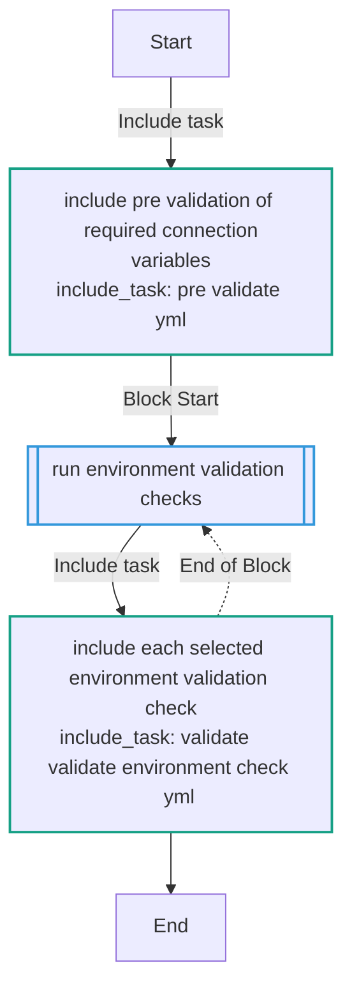
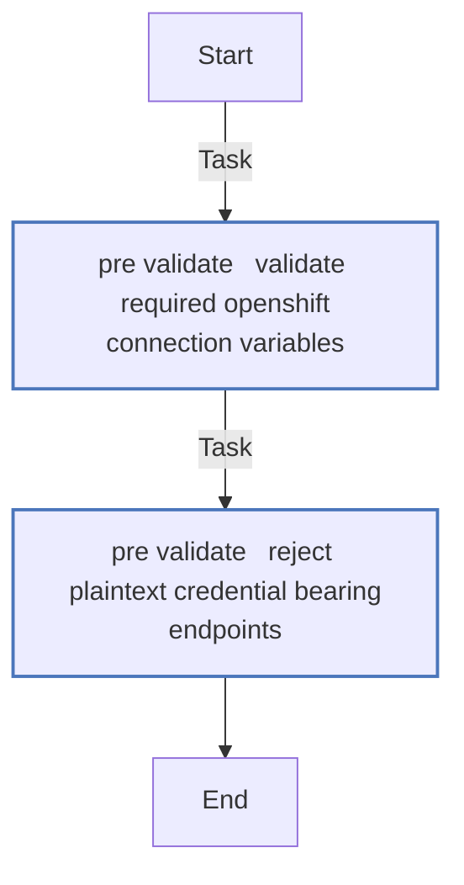
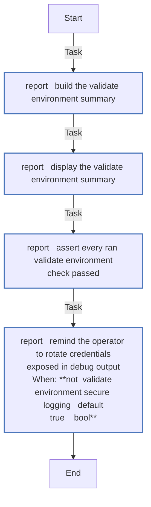
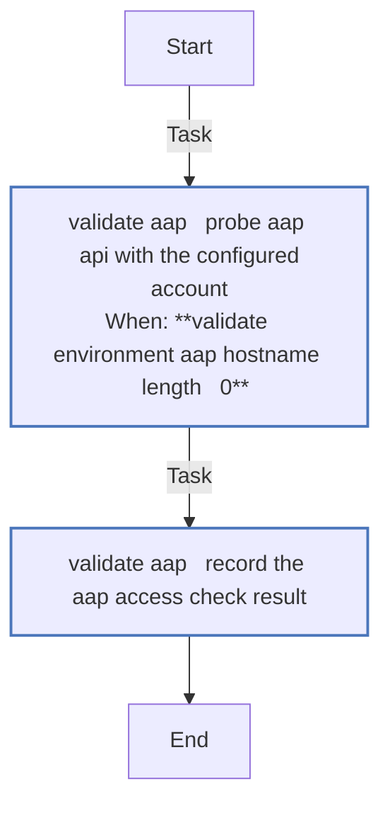
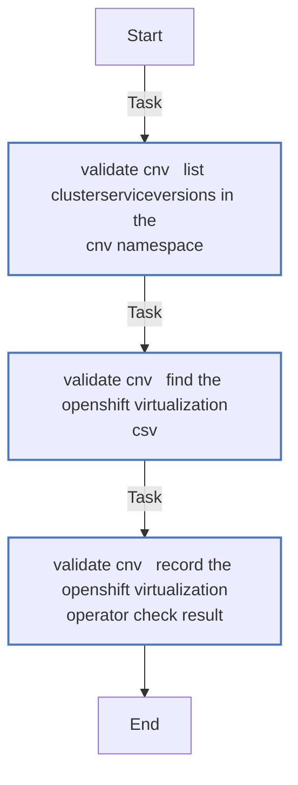
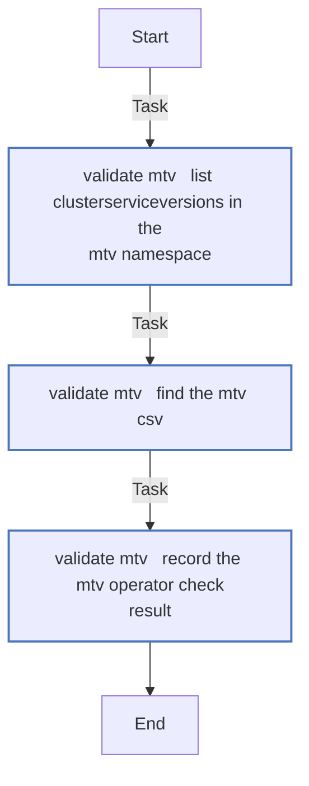
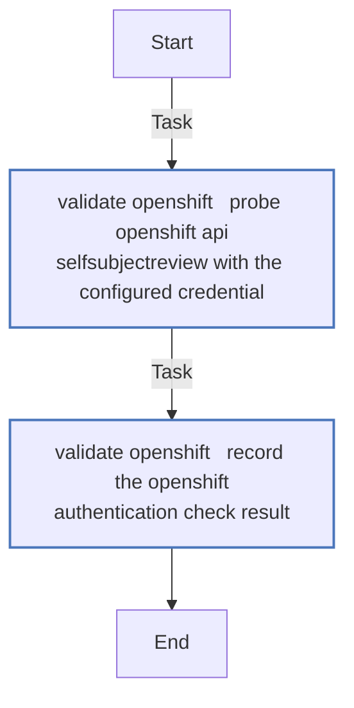
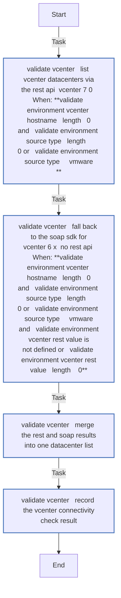
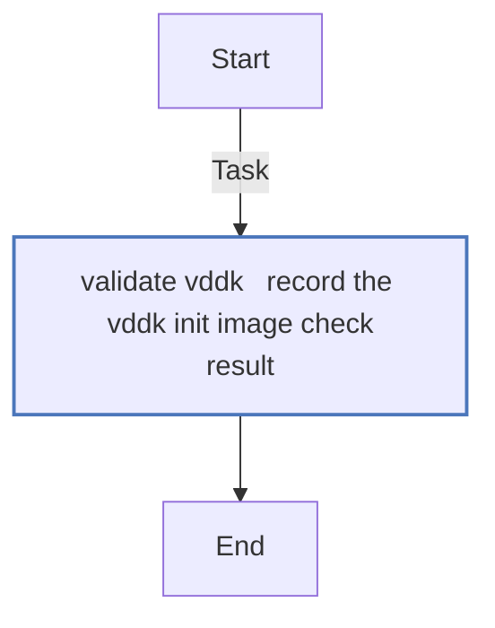

<!-- STATIC CONTENT START -->
# validate_environment

Validate the migration environment before seeding AAP. Runs every check and reports a summary, then fails the play if any check failed — one run reports everything that needs attention.

Automates the manual "Validate your environment" console checks from the journey documentation:

| Check | What it verifies |
| --- | --- |
| OpenShift API auth | `SelfSubjectReview` probe with the configured token |
| OpenShift Virtualization operator | `kubevirt-hyperconverged` CSV exists and is `Succeeded` |
| MTV operator | `mtv-operator` CSV exists and is `Succeeded` |
| AAP access | `/api/v2/me/` probe with the configured account or token |
| vCenter connectivity | Datacenter listing proves connectivity and authentication (vmware sources only; other source types skip it) |
| VDDK init image | Configured, non-empty, and scheme-less (Forklift rejects scheme'd references with `VDDKInitImageUnavailable`; vmware sources only) |

If any check fails, fix it before you seed. Do not seed to paper over a missing operator.

## Example

```bash
ansible-playbook playbooks/vmf_validate_environment.yml \
  --inventory inventory-sample.yml
```

From an AAP job template the target credential injects `K8S_AUTH_*`, the source credential injects `VMWARE_*`, and the controller injects `CONTROLLER_HOST`/`CONTROLLER_API_TOKEN` — the same role runs unchanged.

The AAP access check defaults to the AAP 2.5 platform controller API path (`/api/controller/v2/`). AAP 2.4 and earlier serve the API at `/api/v2/` — set `validate_environment_aap_api_path: /api/v2/` for those environments (a 404 from the AAP check means the path is wrong).

With the sample inventory the connection variables resolve from the target cluster host (`openshift_host`, `openshift_api_key`), the source host (`host`, `username`, `password`, `vddk.image`), and the AAP host (`aap_hostname`, `aap_token`) — selected by `validate_environment_target_name`, `validate_environment_source_name`, and `validate_environment_aap_name`, which default to the `target_name`/`source_name` extra vars (injected by the seeded credentials) or the first host of each group.

All checks run on every invocation, and the summary assert requires every check green. A source whose `type` is not `vmware` (for example `ovirt`) skips the vCenter and VDDK checks.

## Check Mode

Not supported. The connection probes use the `uri` module, which is skipped under `--check`, so a check-mode run reports false authentication failures for the OpenShift and AAP checks. Run the validate_environment without `--check` — every probe is read-only (SelfSubjectReview creates no state, `/api/v2/me/` is a GET, operator queries are list calls).

<!-- STATIC CONTENT END -->
<!-- DOCSIBLE START -->
## validate_environment

```
Role belongs to infra/openshift_virtualization_migration
Namespace - infra
Collection - openshift_virtualization_migration
Version - 1.25.0
Repository - https://github.com/redhat-cop/openshift_virtualization_migration
```

Description: Validate the migration environment before seeding AAP — OpenShift API authentication, OpenShift Virtualization and MTV operator health, AAP access, vCenter connectivity, and VDDK init image configuration.

### Argument Specifications

<details>
<summary><b>🧩 Argument Specifications in `meta/argument_specs`</b></summary>

#### Key: main

* **Description**: ['Runs the selected validate_environment checks and reports a summary, then fails the play if any ran check failed. Checks: OpenShift API auth, CNV and MTV operator health, AAP access, vCenter connectivity, and VDDK init image configuration.', 'Designed to run from an AAP job template (credentials inject K8S_AUTH_*, VMWARE_*, CONTROLLER_HOST, CONTROLLER_API_TOKEN) or a controller with the sample inventory. Connection variables cascade from environment variables to inventory host variables.', 'All checks run by default; validate_environment_checks limits the pass to the named checks. An unconfigured target fails that check with guidance rather than crashing the play, so one run reports everything that needs attention.']
* **Options**:
  * **validate_environment_aap_api_path**:
    * **Required**: False
    * **Type**: str
    * **Default**: /api/controller/v2/
    * **Description**: API base path for the access check. Defaults to /api/controller/v2/ (AAP 2.5 platform deployments); AWX and AAP 2.4 and earlier serve the controller API at /api/v2/ — set that value for those environments.
  * **validate_environment_aap_hostname**:
    * **Required**: False
    * **Type**: str
    * **Default**:
    * **Description**: AAP controller URL for the access check. Resolves from AAP_HOSTNAME env var, the CONTROLLER_HOST env var injected by the controller for its own jobs, or the aap_hostname variable on the AAP host (validate_environment_aap_name). When unset, the AAP check fails with instructions.
  * **validate_environment_aap_name**:
    * **Required**: False
    * **Type**: str
    * **Default**: none
    * **Description**: Inventory host whose aap_* variables feed the AAP check. Defaults to the first migration_aap host.
  * **validate_environment_aap_password**:
    * **Required**: False
    * **Type**: str
    * **Default**:
    * **Description**: AAP password for the access check when no token is set.
  * **validate_environment_aap_token**:
    * **Required**: False
    * **Type**: str
    * **Default**:
    * **Description**: AAP OAuth2 token. Resolves from AAP_TOKEN env var, the CONTROLLER_API_TOKEN env var injected by the controller for its own jobs, or the aap_token variable on the AAP host. Takes precedence over username/password.
  * **validate_environment_aap_username**:
    * **Required**: False
    * **Type**: str
    * **Default**:
    * **Description**: AAP username for the access check.
  * **validate_environment_aap_validate_certs**:
    * **Required**: False
    * **Type**: bool
    * **Default**: True
    * **Description**: Validate the AAP TLS certificate.
  * **validate_environment_checks**:
    * **Required**: False
    * **Type**: list
    * **Default**: ['openshift', 'cnv', 'mtv', 'aap', 'vcenter', 'vddk']
    * **Description**: Which environment validation checks to run, as check-name strings (openshift, cnv, mtv, aap, vcenter, vddk). Defaults to all six. Accepts a list, a bare check name, or a bracketed comma-separated string — the CLI -e form, e.g. -e validate_environment_checks=[vcenter] to debug a single check. An unknown name fails the include with a loud file-not-found error — the summary report still runs.
  * **validate_environment_cnv_namespace**:
    * **Required**: False
    * **Type**: str
    * **Default**: openshift-cnv
    * **Description**: Namespace holding the OpenShift Virtualization operator CSV.
  * **validate_environment_mtv_namespace**:
    * **Required**: False
    * **Type**: str
    * **Default**: openshift-mtv
    * **Description**: Namespace holding the MTV operator CSV. Resolves from the mtv_namespace inventory variable by default.
  * **validate_environment_openshift_api_key**:
    * **Required**: False
    * **Type**: str
    * **Default**:
    * **Description**: OpenShift API token. Resolves from K8S_AUTH_API_KEY env var or the openshift_api_key variable on the target cluster host (validate_environment_target_name). Required — the validate_environment aborts without it.
  * **validate_environment_openshift_host**:
    * **Required**: False
    * **Type**: str
    * **Default**:
    * **Description**: OpenShift API endpoint. Resolves from K8S_AUTH_HOST env var or the openshift_host variable on the target cluster host (validate_environment_target_name). Required — the validate_environment aborts without it.
  * **validate_environment_openshift_verify_ssl**:
    * **Required**: False
    * **Type**: bool
    * **Default**: True
    * **Description**: Validate the OpenShift API TLS certificate.
  * **validate_environment_secure_logging**:
    * **Required**: False
    * **Type**: bool
    * **Default**: True
    * **Description**: Whether to enable secure logging for tasks that handle credentials. Set to false to debug failed probes. Prefer a one-off CLI run (-e validate_environment_secure_logging=false) over flipping the toggle on a job template; if you must, rotate the exposed credential (token or password) afterwards.
  * **validate_environment_source_name**:
    * **Required**: False
    * **Type**: str
    * **Default**: none
    * **Description**: Inventory host whose variables feed the vCenter and VDDK checks. Defaults to the source_name extra var (injected by the seeded credentials) or the first vm_sources host.
  * **validate_environment_target_name**:
    * **Required**: False
    * **Type**: str
    * **Default**: none
    * **Description**: Inventory host whose variables feed the OpenShift checks. Defaults to the target_name extra var (injected by the seeded credentials) or the first migration_clusters host.
  * **validate_environment_vcenter_hostname**:
    * **Required**: False
    * **Type**: str
    * **Default**:
    * **Description**: vCenter endpoint for the connectivity check. Resolves from VMWARE_HOST env var or the host variable on the source host (validate_environment_source_name). The check applies to vmware sources; other source types skip it. When unset, the vCenter check fails with instructions.
  * **validate_environment_vcenter_password**:
    * **Required**: False
    * **Type**: str
    * **Default**:
    * **Description**: vCenter password. Resolves from VMWARE_PASSWORD env var or the password variable on the source host (validate_environment_source_name).
  * **validate_environment_vcenter_username**:
    * **Required**: False
    * **Type**: str
    * **Default**:
    * **Description**: vCenter username. Resolves from VMWARE_USER env var or the username variable on the source host (validate_environment_source_name).
  * **validate_environment_vcenter_validate_certs**:
    * **Required**: False
    * **Type**: bool
    * **Default**: True
    * **Description**: Validate the vCenter TLS certificate.
  * **validate_environment_vddk_image**:
    * **Required**: False
    * **Type**: str
    * **Default**:
    * **Description**: VDDK init image for direct-source migrations. Resolves from the source host's vddk.image dictionary entry or the vddk_image variable. The check enforces a scheme-less reference.

</details>

### Defaults

**These are static variables with lower priority**

#### File: defaults/main.yml

| Var          | Type         | Value       |Choices    |Required    | Title       |
|--------------|--------------|-------------|-------------|-------------|-------------|
| [`validate_environment_aap_api_path`](defaults/main.yml#L145)   | str   | `/api/controller/v2/` |  None  |   False  |  AAP API Path |
| [`validate_environment_aap_hostname`](defaults/main.yml#L131)   | str   | `<multiline value: folded_strip>` |  None  |   False  |  AAP Hostname |
| [`validate_environment_aap_name`](defaults/main.yml#L20)   | str   | `{{ groups['migration_aap'] ¦ default([], true) ¦ first ¦ default('', true) }}` |  None  |   None  |  None |
| [`validate_environment_aap_password`](defaults/main.yml#L163)   | str   | `<multiline value: folded_strip>` |  None  |   False  |  AAP Password |
| [`validate_environment_aap_token`](defaults/main.yml#L176)   | str   | `<multiline value: folded_strip>` |  None  |   False  |  AAP Token |
| [`validate_environment_aap_username`](defaults/main.yml#L152)   | str   | `<multiline value: folded_strip>` |  None  |   False  |  AAP Username |
| [`validate_environment_aap_validate_certs`](defaults/main.yml#L189)   | str   | `{{ (lookup('env', 'AAP_VALIDATE_CERTS') ¦ default(hostvars[validate_environment_aap_name]['aap_validate_certs'] ¦ default(true), true)) ¦ bool }}` |  None  |   False  |  AAP Verify SSL |
| [`validate_environment_checks`](defaults/main.yml#L34)   | list   | `[]` |  None  |   False  |  Checks |
| [`validate_environment_checks.0`](defaults/main.yml#L35)   | str   | `openshift` |  None  |   None  |  None |
| [`validate_environment_checks.1`](defaults/main.yml#L36)   | str   | `cnv` |  None  |   None  |  None |
| [`validate_environment_checks.2`](defaults/main.yml#L37)   | str   | `mtv` |  None  |   None  |  None |
| [`validate_environment_checks.3`](defaults/main.yml#L38)   | str   | `aap` |  None  |   None  |  None |
| [`validate_environment_checks.4`](defaults/main.yml#L39)   | str   | `vcenter` |  None  |   None  |  None |
| [`validate_environment_checks.5`](defaults/main.yml#L40)   | str   | `vddk` |  None  |   None  |  None |
| [`validate_environment_cnv_namespace`](defaults/main.yml#L198)   | str   | `<multiline value: folded_strip>` |  None  |   False  |  CNV Namespace |
| [`validate_environment_mtv_namespace`](defaults/main.yml#L215)   | str   | `<multiline value: folded_strip>` |  None  |   False  |  MTV Namespace |
| [`validate_environment_openshift_api_key`](defaults/main.yml#L61)   | str   | `<multiline value: folded_strip>` |  None  |   True  |  OpenShift API Key |
| [`validate_environment_openshift_host`](defaults/main.yml#L48)   | str   | `<multiline value: folded_strip>` |  None  |   True  |  OpenShift Host |
| [`validate_environment_openshift_verify_ssl`](defaults/main.yml#L78)   | str   | `{{ (lookup('env', 'K8S_AUTH_VERIFY_SSL') ¦ default(hostvars[validate_environment_target_name]['openshift_verify_ssl'] ¦ default(true), true)) ¦ bool }}` |  None  |   False  |  OpenShift Verify SSL |
| [`validate_environment_secure_logging`](defaults/main.yml#L25)   | str   | `{{ secure_logging ¦ default(true) }}` |  None  |   None  |  None |
| [`validate_environment_source_name`](defaults/main.yml#L17)   | str   | `{{ source_name ¦ default(groups['vm_sources'] ¦ default([], true) ¦ first ¦ default('', true), true) }}` |  None  |   None  |  None |
| [`validate_environment_target_name`](defaults/main.yml#L14)   | str   | `{{ target_name ¦ default(groups['migration_clusters'] ¦ default([], true) ¦ first ¦ default('', true), true) }}` |  None  |   None  |  None |
| [`validate_environment_vcenter_hostname`](defaults/main.yml#L87)   | str   | `<multiline value: folded_strip>` |  None  |   False  |  vCenter Hostname |
| [`validate_environment_vcenter_password`](defaults/main.yml#L109)   | str   | `<multiline value: folded_strip>` |  None  |   False  |  vCenter Password |
| [`validate_environment_vcenter_username`](defaults/main.yml#L98)   | str   | `<multiline value: folded_strip>` |  None  |   False  |  vCenter Username |
| [`validate_environment_vcenter_validate_certs`](defaults/main.yml#L121)   | str   | `{{ (lookup('env', 'VMWARE_VALIDATE_CERTS') ¦ default(hostvars[validate_environment_source_name]['validate_certs'] ¦ default(true), true)) ¦ bool }}` |  None  |   False  |  vCenter Verify SSL |
| [`validate_environment_vddk_image`](defaults/main.yml#L232)   | str   | `<multiline value: folded_strip>` |  None  |   False  |  VDDK Init Image |

<summary><b>🖇️ Full descriptions for vars in defaults/main.yml</b></summary>
<br>
<b>`validate_environment_aap_api_path`:</b> >-
<br>
<b>`validate_environment_aap_hostname`:</b> >-
<br>
<b>`validate_environment_aap_name`:</b> None
<br>
<b>`validate_environment_aap_password`:</b> >-
<br>
<b>`validate_environment_aap_token`:</b> >-
<br>
<b>`validate_environment_aap_username`:</b> >-
<br>
<b>`validate_environment_aap_validate_certs`:</b> >-
<br>
<b>`validate_environment_checks`:</b> >-
<br>
<b>`validate_environment_checks.0`:</b> None
<br>
<b>`validate_environment_checks.1`:</b> None
<br>
<b>`validate_environment_checks.2`:</b> None
<br>
<b>`validate_environment_checks.3`:</b> None
<br>
<b>`validate_environment_checks.4`:</b> None
<br>
<b>`validate_environment_checks.5`:</b> None
<br>
<b>`validate_environment_cnv_namespace`:</b> >-
<br>
<b>`validate_environment_mtv_namespace`:</b> >-
<br>
<b>`validate_environment_openshift_api_key`:</b> >-
<br>
<b>`validate_environment_openshift_host`:</b> >-
<br>
<b>`validate_environment_openshift_verify_ssl`:</b> >-
<br>
<b>`validate_environment_secure_logging`:</b> None
<br>
<b>`validate_environment_source_name`:</b> None
<br>
<b>`validate_environment_target_name`:</b> None
<br>
<b>`validate_environment_vcenter_hostname`:</b> >-
<br>
<b>`validate_environment_vcenter_password`:</b> >-
<br>
<b>`validate_environment_vcenter_username`:</b> >-
<br>
<b>`validate_environment_vcenter_validate_certs`:</b> >-
<br>
<b>`validate_environment_vddk_image`:</b> >-
<br>
<br>

### Vars

**These are variables with higher priority**

#### File: vars/main.yml

| Var          | Type         | Value       |
|--------------|--------------|-------------|
| [__validate_environment_source_type](vars/main.yml#L4)   | str   | `{{ hostvars[validate_environment_source_name]['type'] ¦ default('', true) }}` |
| [__validate_environment_source_vddk](vars/main.yml#L8)   | str   | `{{ hostvars[validate_environment_source_name]['vddk'] ¦ default({}, true) }}` |

### Tasks

#### File: tasks/main.yml

| Name | Module | Has Conditions |
| ---- | ------ | --------- |
| Include pre-validation of required connection variables | `ansible.builtin.include_tasks` | False |
| Run environment validation checks | `block` | False |
| Include each selected environment validation check | `ansible.builtin.include_tasks` | False |

#### File: tasks/pre_validate.yml

| Name | Module | Has Conditions |
| ---- | ------ | --------- |
| pre_validate ¦ Validate required OpenShift connection variables | `ansible.builtin.assert` | False |
| pre_validate ¦ Reject plaintext credential-bearing endpoints | `ansible.builtin.assert` | False |

#### File: tasks/report.yml

| Name | Module | Has Conditions |
| ---- | ------ | --------- |
| report ¦ Build the validate_environment summary | `ansible.builtin.set_fact` | False |
| report ¦ Display the validate_environment summary | `ansible.builtin.debug` | False |
| report ¦ Assert every ran validate_environment check passed | `ansible.builtin.assert` | False |
| report ¦ Remind the operator to rotate credentials exposed in debug output | `ansible.builtin.debug` | True |

#### File: tasks/validate_aap.yml

| Name | Module | Has Conditions |
| ---- | ------ | --------- |
| validate_aap ¦ Probe AAP API with the configured account | `ansible.builtin.uri` | True |
| validate_aap ¦ Record the AAP access check result | `ansible.builtin.set_fact` | False |

#### File: tasks/validate_cnv.yml

| Name | Module | Has Conditions |
| ---- | ------ | --------- |
| validate_cnv ¦ List ClusterServiceVersions in the CNV namespace | `kubernetes.core.k8s_info` | False |
| validate_cnv ¦ Find the OpenShift Virtualization CSV | `ansible.builtin.set_fact` | False |
| validate_cnv ¦ Record the OpenShift Virtualization operator check result | `ansible.builtin.set_fact` | False |

#### File: tasks/validate_mtv.yml

| Name | Module | Has Conditions |
| ---- | ------ | --------- |
| validate_mtv ¦ List ClusterServiceVersions in the MTV namespace | `kubernetes.core.k8s_info` | False |
| validate_mtv ¦ Find the MTV CSV | `ansible.builtin.set_fact` | False |
| validate_mtv ¦ Record the MTV operator check result | `ansible.builtin.set_fact` | False |

#### File: tasks/validate_openshift.yml

| Name | Module | Has Conditions |
| ---- | ------ | --------- |
| validate_openshift ¦ Probe OpenShift API SelfSubjectReview with the configured credential | `ansible.builtin.uri` | False |
| validate_openshift ¦ Record the OpenShift authentication check result | `ansible.builtin.set_fact` | False |

#### File: tasks/validate_vcenter.yml

| Name | Module | Has Conditions |
| ---- | ------ | --------- |
| validate_vcenter ¦ List vCenter datacenters via the REST API (vCenter 7.0+) | `vmware.vmware_rest.vcenter_datacenter_info` | True |
| validate_vcenter ¦ Fall back to the SOAP SDK for vCenter 6.x (no REST API) | `community.vmware.vmware_datacenter_info` | True |
| validate_vcenter ¦ Merge the REST and SOAP results into one datacenter list | `ansible.builtin.set_fact` | False |
| validate_vcenter ¦ Record the vCenter connectivity check result | `ansible.builtin.set_fact` | False |

#### File: tasks/validate_vddk.yml

| Name | Module | Has Conditions |
| ---- | ------ | --------- |
| validate_vddk ¦ Record the VDDK init image check result | `ansible.builtin.set_fact` | False |

## Task Flow Graphs

### Graph for main.yml



### Graph for pre_validate.yml



### Graph for report.yml



### Graph for validate_aap.yml



### Graph for validate_cnv.yml



### Graph for validate_mtv.yml



### Graph for validate_openshift.yml



### Graph for validate_vcenter.yml



### Graph for validate_vddk.yml



## Author Information

Red Hat

## License

GPL-3.0-only

## Minimum Ansible Version

2.16

## Platforms

* **EL**: ['all']

<!-- DOCSIBLE END -->