<!-- STATIC CONTENT START -->
# validate_migration

Validate migration outcomes after vmf_migrate completes. Runs every check and reports a summary, then fails the play if any check failed — one run reports everything that needs attention.

| Check | What it verifies |
| --- | --- |
| Migration plan status | The Plan's latest Migration object reports `Succeeded` |
| Migrated VMs present and running | Every expected VM exists as a `VirtualMachine` in the target namespace with `printableStatus` `Running` |
| Target list matches | Every expected VM is present (expected subset); extra VMs in the namespace are reported as warnings |
| Guest agent responsive | `qemu-guest-agent` data present in the VMI status (warn-only) |
| IP addresses match | The migrated VM reports its source vCenter address (warn-only — DHCP may reassign the lease) |
| Disk topology matches | Source disk count (vCenter hardware) matches the migrated VM's data volume count |
| Source power-off | Hard-stops source VMs whose counterpart passed every fatal check — per-VM and fail-closed (docs/adr/0001-validate-migration-fail-closed-power-off.md); report-only when disabled |

## Example

```bash
ansible-playbook playbooks/vmf_validate_migration.yml \
  --inventory inventory-sample.yml \
  --extra-vars '{"mtv_migrate_plan_name": "plan-1", "mtv_migrate_plan_namespace": "migration", "validate_migration_vm_list": ["vm-a", "vm-b"]}'
```

From an AAP job template the target credential injects `K8S_AUTH_*` and the source credential injects `VMWARE_*` — the same role runs unchanged. The plan name and namespace default from `mtv_migrate_plan_name`/`mtv_migrate_plan_namespace`, so validate_migration runs seamlessly with the same extra vars as vmf_migrate.

With the sample inventory the connection variables resolve from the target cluster host (`openshift_host`, `openshift_api_key`) and the source host (`host`, `username`, `password`) — selected by `validate_migration_target_name` and `validate_migration_source_name`, which default to the `target_name`/`source_name` extra vars (injected by the seeded credentials) or the first host of each group.

All checks run on every invocation, and the summary assert requires every ran check green. A source whose `type` is not `vmware` (for example `ovirt`) skips the vCenter source checks.

The source power-off is the only sanctioned mutation: per-VM and fail-closed, a source VM powers off only after its migrated counterpart passed every fatal check. Set `validate_migration_power_off_source: false` to run read-only.

## VMware compatibility

Gathering uses `community.vmware.vmware_guest_info` through SOAP only: the
certified `vmware.vmware.vm_info` also initializes REST, which is not an
acceptable prerequisite for unknown legacy vCenters and the demo emulator.
Power-off uses certified `vmware.vmware.vm_powerstate` (collection >=1.11.0),
also through SOAP, and requires `validate_migration_vcenter_datacenter` to be nonempty.
Missing datacenter fails the power check without issuing a power-off; it is
optional in report-only mode.

SOAP transport is not a support guarantee. No legacy-vCenter or emulator
combination has yet been verified for this role. Validate each required
endpoint and execution-environment SDK combination in an authorized lab;
emulator success does not establish real-vCenter compatibility or vice versa.
Use report-only mode first. Missing/unsupported facts fail closed, and an
action error reports an unknown final power state, not a successful cutover.
MoID targets the object just gathered, but cannot distinguish an original
source from a VM recreated under the same name after migration.

## Check Mode

Supported for reading. The read probes (`kubernetes.core.k8s_info` queries and the `vmware_guest_info` lookups) run under `--check`, and no source VM is powered off — a check-mode run validates without mutating. Run without `--check` to cut over.

<!-- STATIC CONTENT END -->
<!-- DOCSIBLE START -->
## validate_migration

```
Role belongs to infra/openshift_virtualization_migration
Namespace - infra
Collection - openshift_virtualization_migration
Version - 1.25.0
Repository - https://github.com/redhat-cop/openshift_virtualization_migration
```

Description: Validate migration outcomes after vmf_migrate completes — Migration status, migrated VM presence and state, target list match, guest agent, IP addresses, disk topology, and the fail-closed source power-off.

### Argument Specifications

<details>
<summary><b>🧩 Argument Specifications in `meta/argument_specs`</b></summary>

#### Key: main

* **Description**: ['Runs every validate_migration check and reports a summary, then fails the play if any check failed. Checks: migration plan status, migrated VM presence and running state, target list match, guest agent, IP addresses, disk topology, and the source power-off. An unconfigured target fails with guidance rather than crashing the play.', 'Designed to run from an AAP job template (credentials inject K8S_AUTH_* and VMWARE_*) or a controller with the sample inventory. Connection variables cascade from environment variables to inventory host variables.', 'The source power-off is the only sanctioned mutation: per-VM and fail-closed — a source VM powers off only after its counterpart passed every fatal check. Set validate_migration_power_off_source=false to run read-only.']
* **Options**:
  * **validate_migration_openshift_api_key**:
    * **Required**: False
    * **Type**: str
    * **Default**:
    * **Description**: OpenShift API token. Resolves from K8S_AUTH_API_KEY env var or the openshift_api_key variable on the target cluster host (validate_migration_target_name). Required — the validate_migration aborts without it.
  * **validate_migration_openshift_host**:
    * **Required**: False
    * **Type**: str
    * **Default**:
    * **Description**: OpenShift API endpoint. Resolves from K8S_AUTH_HOST env var or the openshift_host variable on the target cluster host (validate_migration_target_name). Required — the validate_migration aborts without it.
  * **validate_migration_openshift_verify_ssl**:
    * **Required**: False
    * **Type**: bool
    * **Default**: True
    * **Description**: Validate the OpenShift API TLS certificate.
  * **validate_migration_plan_name**:
    * **Required**: False
    * **Type**: str
    * **Default**:
    * **Description**: Name of the MTV (Forklift) Plan whose migration validate_migration validates. Defaults to the mtv_migrate_plan_name variable so validate_migration runs seamlessly after vmf_migrate. Required — the validate_migration aborts without it.
  * **validate_migration_plan_namespace**:
    * **Required**: False
    * **Type**: str
    * **Default**:
    * **Description**: Namespace holding the migration Plan and its Migration objects. Defaults to the mtv_migrate_plan_namespace variable. Required — the validate_migration aborts without it.
  * **validate_migration_power_off_source**:
    * **Required**: False
    * **Type**: bool
    * **Default**: True
    * **Description**: Power off source VMs whose migrated counterpart passed every fatal check (per-VM, fail-closed — a failed check leaves that source running). The power-off is a hard stop via the vCenter API and the only sanctioned mutation in this role. Set false to run read-only: the role reports source power state without mutating.
  * **validate_migration_secure_logging**:
    * **Required**: False
    * **Type**: bool
    * **Default**: True
    * **Description**: Whether to enable secure logging for tasks that handle credentials. Set to false to debug failed probes. Prefer a one-off CLI run (-e validate_migration_secure_logging=false) over flipping the toggle on a job template; if you must, rotate the exposed credential afterwards.
  * **validate_migration_source_name**:
    * **Required**: False
    * **Type**: str
    * **Default**: none
    * **Description**: Inventory host whose variables feed the vCenter checks. Defaults to the source_name extra var (injected by the seeded credentials) or the first vm_sources host.
  * **validate_migration_target_name**:
    * **Required**: False
    * **Type**: str
    * **Default**: none
    * **Description**: Inventory host whose variables feed the OpenShift checks. Defaults to the target_name extra var (injected by the seeded credentials) or the first migration_clusters host.
  * **validate_migration_target_namespace**:
    * **Required**: False
    * **Type**: str
    * **Default**:
    * **Description**: Namespace holding the migrated VirtualMachines — the Plan's target namespace. Defaults to the Plan namespace.
  * **validate_migration_vcenter_datacenter**:
    * **Required**: False
    * **Type**: str
    * **Default**:
    * **Description**: Datacenter for source VM lookup and power-off. Required for enabled power-off; optional for read-only gathering. A missing value fails the power check without mutating any source VM.
  * **validate_migration_vcenter_hostname**:
    * **Required**: False
    * **Type**: str
    * **Default**:
    * **Description**: vCenter endpoint for the source VM checks. Resolves from VMWARE_HOST env var or the host variable on the source host (validate_migration_source_name). When unset, the source checks fail with instructions.
  * **validate_migration_vcenter_password**:
    * **Required**: False
    * **Type**: str
    * **Default**:
    * **Description**: vCenter password. Resolves from VMWARE_PASSWORD env var or the password variable on the source host (validate_migration_source_name). When validate_migration_power_off_source is true, the credential needs the power off permission.
  * **validate_migration_vcenter_username**:
    * **Required**: False
    * **Type**: str
    * **Default**:
    * **Description**: vCenter username. Resolves from VMWARE_USER env var or the username variable on the source host (validate_migration_source_name).
  * **validate_migration_vcenter_validate_certs**:
    * **Required**: False
    * **Type**: bool
    * **Default**: True
    * **Description**: Validate the vCenter TLS certificate.
  * **validate_migration_vm_list**:
    * **Required**: False
    * **Type**: list
    * **Default**: []
    * **Description**: Explicit list of source VM names to validate. MTV preserves VM names, so each name is also the migrated VirtualMachine's name in the target namespace. Required — the validate_migration aborts with an empty list.

</details>

### Defaults

**These are static variables with lower priority**

#### File: defaults/main.yml

| Var          | Type         | Value       |Choices    |Required    | Title       |
|--------------|--------------|-------------|-------------|-------------|-------------|
| [`validate_migration_openshift_api_key`](defaults/main.yml#L44)   | str   | `<multiline value: folded_strip>` |  None  |   True  |  OpenShift API Key |
| [`validate_migration_openshift_host`](defaults/main.yml#L31)   | str   | `<multiline value: folded_strip>` |  None  |   True  |  OpenShift Host |
| [`validate_migration_openshift_verify_ssl`](defaults/main.yml#L61)   | str   | `{{ (lookup('env', 'K8S_AUTH_VERIFY_SSL') ¦ default(hostvars[validate_migration_target_name]['openshift_verify_ssl'] ¦ default(true), true)) ¦ bool }}` |  None  |   False  |  OpenShift Verify SSL |
| [`validate_migration_plan_name`](defaults/main.yml#L128)   | str   | `{{ mtv_migrate_plan_name ¦ default('', true) }}` |  None  |   True  |  Migration Plan Name |
| [`validate_migration_plan_namespace`](defaults/main.yml#L135)   | str   | `{{ mtv_migrate_plan_namespace ¦ default('', true) }}` |  None  |   True  |  Migration Plan Namespace |
| [`validate_migration_power_off_source`](defaults/main.yml#L161)   | bool   | `True` |  None  |   False  |  Source Power-Off |
| [`validate_migration_secure_logging`](defaults/main.yml#L23)   | str   | `{{ secure_logging ¦ default(true) }}` |  None  |   None  |  None |
| [`validate_migration_source_name`](defaults/main.yml#L16)   | str   | `{{ source_name ¦ default(groups['vm_sources'] ¦ default([], true) ¦ first ¦ default('', true), true) }}` |  None  |   None  |  None |
| [`validate_migration_target_name`](defaults/main.yml#L13)   | str   | `{{ target_name ¦ default(groups['migration_clusters'] ¦ default([], true) ¦ first ¦ default('', true), true) }}` |  None  |   None  |  None |
| [`validate_migration_target_namespace`](defaults/main.yml#L142)   | str   | `{{ validate_migration_plan_namespace }}` |  None  |   False  |  Target Namespace |
| [`validate_migration_vcenter_datacenter`](defaults/main.yml#L119)   | str   | `<multiline value: folded_strip>` |  None  |   False  |  vCenter Datacenter |
| [`validate_migration_vcenter_hostname`](defaults/main.yml#L71)   | str   | `<multiline value: folded_strip>` |  None  |   False  |  vCenter Hostname |
| [`validate_migration_vcenter_password`](defaults/main.yml#L96)   | str   | `<multiline value: folded_strip>` |  None  |   False  |  vCenter Password |
| [`validate_migration_vcenter_username`](defaults/main.yml#L82)   | str   | `<multiline value: folded_strip>` |  None  |   False  |  vCenter Username |
| [`validate_migration_vcenter_validate_certs`](defaults/main.yml#L110)   | str   | `{{ (lookup('env', 'VMWARE_VALIDATE_CERTS') ¦ default(hostvars[validate_migration_source_name]['validate_certs'] ¦ default(true), true)) ¦ bool }}` |  None  |   False  |  vCenter Verify SSL |
| [`validate_migration_vm_list`](defaults/main.yml#L150)   | list   | `[]` |  None  |   True  |  VM List |

<summary><b>🖇️ Full descriptions for vars in defaults/main.yml</b></summary>
<br>
<b>`validate_migration_openshift_api_key`:</b> >-
<br>
<b>`validate_migration_openshift_host`:</b> >-
<br>
<b>`validate_migration_openshift_verify_ssl`:</b> >-
<br>
<b>`validate_migration_plan_name`:</b> >-
<br>
<b>`validate_migration_plan_namespace`:</b> >-
<br>
<b>`validate_migration_power_off_source`:</b> >-
<br>
<b>`validate_migration_secure_logging`:</b> None
<br>
<b>`validate_migration_source_name`:</b> None
<br>
<b>`validate_migration_target_name`:</b> None
<br>
<b>`validate_migration_target_namespace`:</b> >-
<br>
<b>`validate_migration_vcenter_datacenter`:</b> >-
<br>
<b>`validate_migration_vcenter_hostname`:</b> >-
<br>
<b>`validate_migration_vcenter_password`:</b> >-
<br>
<b>`validate_migration_vcenter_username`:</b> >-
<br>
<b>`validate_migration_vcenter_validate_certs`:</b> >-
<br>
<b>`validate_migration_vm_list`:</b> >-
<br>
<br>

### Vars

**These are variables with higher priority**

#### File: vars/main.yml

| Var          | Type         | Value       |
|--------------|--------------|-------------|
| [__validate_migration_source_type](vars/main.yml#L4)   | str   | `{{ hostvars[validate_migration_source_name]['type'] ¦ default('', true) }}` |

### Tasks

#### File: tasks/main.yml

| Name | Module | Has Conditions |
| ---- | ------ | --------- |
| Include pre-validation of required variables | `ansible.builtin.include_tasks` | False |
| Run migration validation checks | `block` | False |
| Include migration plan status check | `ansible.builtin.include_tasks` | False |
| Include migrated VM presence and state check | `ansible.builtin.include_tasks` | False |
| Include target list match check | `ansible.builtin.include_tasks` | False |
| Include guest agent check | `ansible.builtin.include_tasks` | False |
| Include IP address check | `ansible.builtin.include_tasks` | False |
| Include disk topology check | `ansible.builtin.include_tasks` | False |
| Include the source power-off action | `ansible.builtin.include_tasks` | False |

#### File: tasks/gather_source_vm.yml

| Name | Module | Has Conditions |
| ---- | ------ | --------- |
| gather_source_vm ¦ Gather source VM facts from vCenter (SOAP) | `community.vmware.vmware_guest_info` | True |

#### File: tasks/gather_target_k8s.yml

| Name | Module | Has Conditions |
| ---- | ------ | --------- |
| gather_target_k8s ¦ Query OpenShift Virtualization objects | `kubernetes.core.k8s_info` | False |

#### File: tasks/power_off.yml

| Name | Module | Has Conditions |
| ---- | ------ | --------- |
| power_off ¦ Gather source VM facts (moid and power state) | `ansible.builtin.include_tasks` | False |
| power_off ¦ Compute the per-VM fail-closed gate | `ansible.builtin.set_fact` | False |
| power_off ¦ Normalize the source lookup results | `ansible.builtin.set_fact` | False |
| power_off ¦ Power off validated source VMs (hard stop) | `vmware.vmware.vm_powerstate` | True |
| power_off ¦ Classify and record the source power-off results | `ansible.builtin.include_tasks` | False |

#### File: tasks/power_report.yml

| Name | Module | Has Conditions |
| ---- | ------ | --------- |
| power_report ¦ Classify each expected source VM | `ansible.builtin.set_fact` | False |
| power_report ¦ Record the source power-off check | `ansible.builtin.set_fact` | False |

#### File: tasks/pre_validate.yml

| Name | Module | Has Conditions |
| ---- | ------ | --------- |
| pre_validate ¦ Validate required OpenShift connection variables | `ansible.builtin.assert` | False |
| pre_validate ¦ Validate required migration identifiers | `ansible.builtin.assert` | False |
| pre_validate ¦ Reject plaintext credential-bearing endpoints | `ansible.builtin.assert` | False |

#### File: tasks/report.yml

| Name | Module | Has Conditions |
| ---- | ------ | --------- |
| report ¦ Build the validate_migration summary | `ansible.builtin.set_fact` | False |
| report ¦ Display the validate_migration summary | `ansible.builtin.debug` | False |
| report ¦ Assert every ran validate_migration check passed | `ansible.builtin.assert` | False |
| report ¦ Remind the operator to rotate credentials exposed in debug output | `ansible.builtin.debug` | True |

#### File: tasks/validate_agent.yml

| Name | Module | Has Conditions |
| ---- | ------ | --------- |
| validate_agent ¦ Query VirtualMachineInstances in the target namespace | `ansible.builtin.include_tasks` | False |
| validate_agent ¦ Build the per-VM agent status map | `ansible.builtin.set_fact` | False |
| validate_agent ¦ Record the guest agent check result | `ansible.builtin.set_fact` | False |

#### File: tasks/validate_disks.yml

| Name | Module | Has Conditions |
| ---- | ------ | --------- |
| validate_disks ¦ Gather source disk topology from vCenter | `ansible.builtin.include_tasks` | False |
| validate_disks ¦ Query the migrated VirtualMachines' volume counts | `ansible.builtin.include_tasks` | False |
| validate_disks ¦ Build the per-VM disk comparison map | `ansible.builtin.set_fact` | False |
| validate_disks ¦ Count the disk topology mismatches | `ansible.builtin.set_fact` | False |
| validate_disks ¦ Record the disk topology check result | `ansible.builtin.set_fact` | False |

#### File: tasks/validate_ip.yml

| Name | Module | Has Conditions |
| ---- | ------ | --------- |
| validate_ip ¦ Gather source VM facts from vCenter | `ansible.builtin.include_tasks` | False |
| validate_ip ¦ Query VirtualMachineInstances for the target addresses | `ansible.builtin.include_tasks` | False |
| validate_ip ¦ Build the per-VM address comparison map | `ansible.builtin.set_fact` | False |
| validate_ip ¦ Record the IP address check result | `ansible.builtin.set_fact` | False |

#### File: tasks/validate_list.yml

| Name | Module | Has Conditions |
| ---- | ------ | --------- |
| validate_list ¦ Query migrated VirtualMachines in the target namespace | `ansible.builtin.include_tasks` | False |
| validate_list ¦ Resolve the found VM names | `ansible.builtin.set_fact` | False |
| validate_list ¦ Split the found VMs into missing and extra | `ansible.builtin.set_fact` | False |
| validate_list ¦ Record the target list check result | `ansible.builtin.set_fact` | False |

#### File: tasks/validate_plan.yml

| Name | Module | Has Conditions |
| ---- | ------ | --------- |
| validate_plan ¦ Query the migration Plan | `kubernetes.core.k8s_info` | False |
| validate_plan ¦ Query Migration objects in the plan namespace | `kubernetes.core.k8s_info` | False |
| validate_plan ¦ Resolve the latest Migration object for the plan | `ansible.builtin.set_fact` | False |
| validate_plan ¦ Record the resolved Migration object name | `ansible.builtin.set_fact` | False |
| validate_plan ¦ Interpret the Migration status | `infra.openshift_virtualization_migration.mtv_migration_status` | True |
| validate_plan ¦ Record the plan status check result | `ansible.builtin.set_fact` | False |

#### File: tasks/validate_vms.yml

| Name | Module | Has Conditions |
| ---- | ------ | --------- |
| validate_vms ¦ Query migrated VirtualMachines in the target namespace | `ansible.builtin.include_tasks` | False |
| validate_vms ¦ Build the per-VM presence and state map | `ansible.builtin.set_fact` | False |
| validate_vms ¦ Record the migrated VM check result | `ansible.builtin.set_fact` | False |

## Task Flow Graphs

### Graph for gather_source_vm.yml

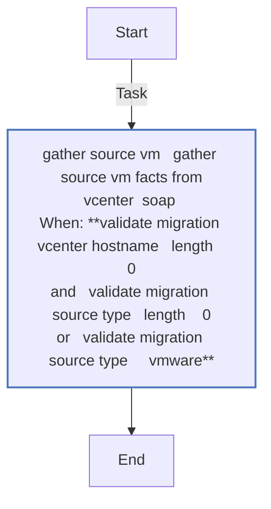

### Graph for gather_target_k8s.yml

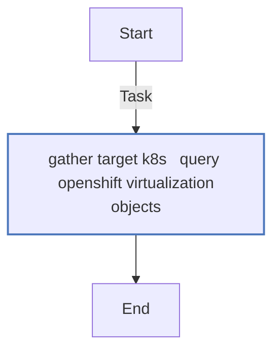

### Graph for main.yml

```mermaid
flowchart TD
Start
classDef block stroke:#3498db,stroke-width:2px;
classDef task stroke:#4b76bb,stroke-width:2px;
classDef includeTasks stroke:#16a085,stroke-width:2px;
classDef importTasks stroke:#34495e,stroke-width:2px;
classDef includeRole stroke:#2980b9,stroke-width:2px;
classDef importRole stroke:#699ba7,stroke-width:2px;
classDef includeVars stroke:#8e44ad,stroke-width:2px;
classDef rescue stroke:#665352,stroke-width:2px;

  Start-->|Include task| Include_pre_validation_of_required_variables_pre_validate_yml_0[include pre validation of required variables<br>include_task: pre validate yml]:::includeTasks
  Include_pre_validation_of_required_variables_pre_validate_yml_0-->|Block Start| Run_migration_validation_checks1_block_start_0[[run migration validation checks]]:::block
  Run_migration_validation_checks1_block_start_0-->|Include task| Include_migration_plan_status_check_validate_plan_yml_0[include migration plan status check<br>include_task: validate plan yml]:::includeTasks
  Include_migration_plan_status_check_validate_plan_yml_0-->|Include task| Include_migrated_VM_presence_and_state_check_validate_vms_yml_1[include migrated vm presence and state check<br>include_task: validate vms yml]:::includeTasks
  Include_migrated_VM_presence_and_state_check_validate_vms_yml_1-->|Include task| Include_target_list_match_check_validate_list_yml_2[include target list match check<br>include_task: validate list yml]:::includeTasks
  Include_target_list_match_check_validate_list_yml_2-->|Include task| Include_guest_agent_check_validate_agent_yml_3[include guest agent check<br>include_task: validate agent yml]:::includeTasks
  Include_guest_agent_check_validate_agent_yml_3-->|Include task| Include_IP_address_check_validate_ip_yml_4[include ip address check<br>include_task: validate ip yml]:::includeTasks
  Include_IP_address_check_validate_ip_yml_4-->|Include task| Include_disk_topology_check_validate_disks_yml_5[include disk topology check<br>include_task: validate disks yml]:::includeTasks
  Include_disk_topology_check_validate_disks_yml_5-->|Include task| Include_the_source_power_off_action_power_off_yml_6[include the source power off action<br>include_task: power off yml]:::includeTasks
  Include_the_source_power_off_action_power_off_yml_6-.->|End of Block| Run_migration_validation_checks1_block_start_0
  Include_the_source_power_off_action_power_off_yml_6-->End
```

### Graph for power_off.yml

```mermaid
flowchart TD
Start
classDef block stroke:#3498db,stroke-width:2px;
classDef task stroke:#4b76bb,stroke-width:2px;
classDef includeTasks stroke:#16a085,stroke-width:2px;
classDef importTasks stroke:#34495e,stroke-width:2px;
classDef includeRole stroke:#2980b9,stroke-width:2px;
classDef importRole stroke:#699ba7,stroke-width:2px;
classDef includeVars stroke:#8e44ad,stroke-width:2px;
classDef rescue stroke:#665352,stroke-width:2px;

  Start-->|Include task| power_off___Gather_source_VM_facts__moid_and_power_state__gather_source_vm_yml_0[power off   gather source vm facts  moid and power<br>state <br>include_task: gather source vm yml]:::includeTasks
  power_off___Gather_source_VM_facts__moid_and_power_state__gather_source_vm_yml_0-->|Task| power_off___Compute_the_per_VM_fail_closed_gate1[power off   compute the per vm fail closed gate]:::task
  power_off___Compute_the_per_VM_fail_closed_gate1-->|Task| power_off___Normalize_the_source_lookup_results2[power off   normalize the source lookup results]:::task
  power_off___Normalize_the_source_lookup_results2-->|Task| power_off___Power_off_validated_source_VMs__hard_stop_3[power off   power off validated source vms  hard<br>stop <br>When: **validate migration power off source   bool and not<br>ansible check mode and validate migration vcenter<br>datacenter   trim   length   0 and   validate<br>migration power gate get   validate migration<br>power name  false    bool and   validate migration<br>power sources   validate migration power name <br>valid   bool and   validate migration power<br>sources   validate migration power name   instance<br>hw power status in   poweredon    suspended**]:::task
  power_off___Power_off_validated_source_VMs__hard_stop_3-->|Include task| power_off___Classify_and_record_the_source_power_off_results_power_report_yml_4[power off   classify and record the source power<br>off results<br>include_task: power report yml]:::includeTasks
  power_off___Classify_and_record_the_source_power_off_results_power_report_yml_4-->End
```

### Graph for power_report.yml

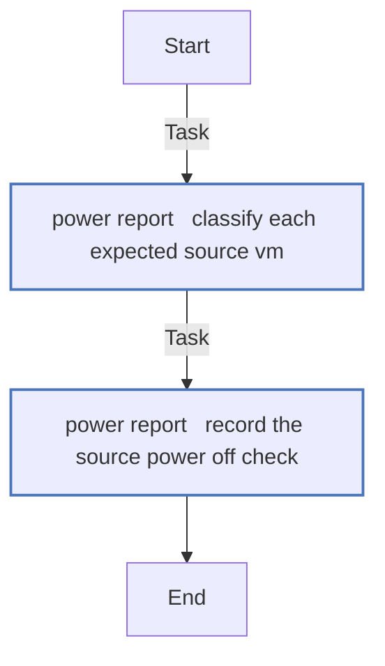

### Graph for pre_validate.yml

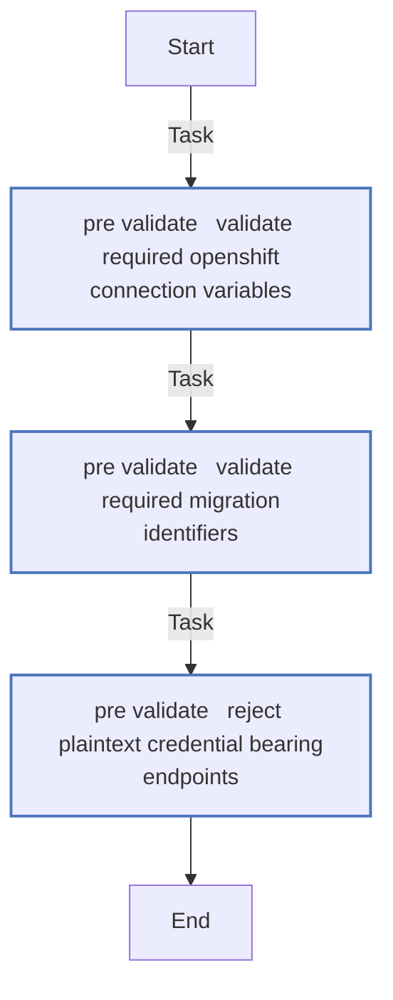

### Graph for report.yml

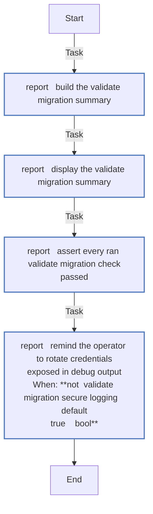

### Graph for validate_agent.yml

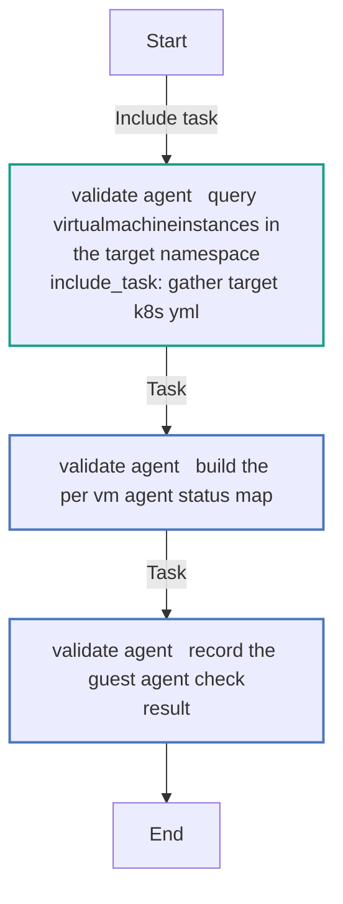

### Graph for validate_disks.yml

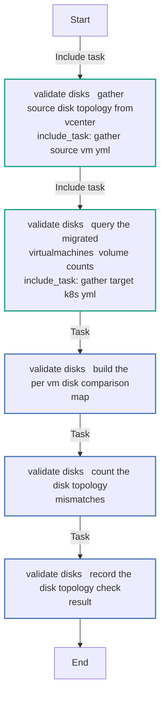

### Graph for validate_ip.yml

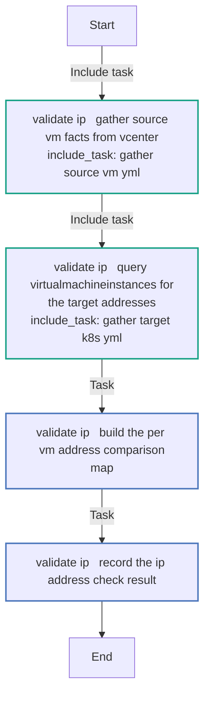

### Graph for validate_list.yml

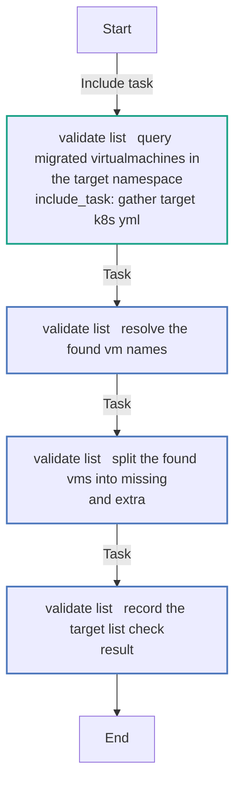

### Graph for validate_plan.yml

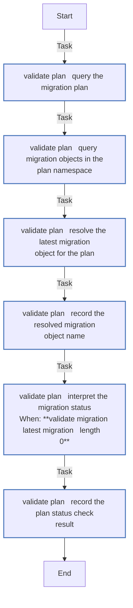

### Graph for validate_vms.yml

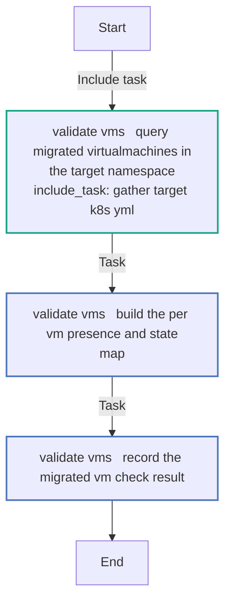

## Author Information

Red Hat

## License

GPL-3.0-only

## Minimum Ansible Version

2.16

## Platforms

* **EL**: ['all']

<!-- DOCSIBLE END -->